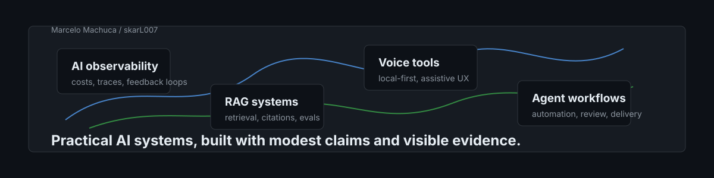

<p align="center">
  
</p>

<h1 align="center">Marcelo Machuca</h1>

<p align="center">
  AI Solutions Developer working with Python, TypeScript, RAG, voice tools and observability.<br />
  I came from medicine. I design AI systems and direct the coding agents that write them;<br />my part is the architecture, the boundaries and the proof: tests, metrics and cost.
</p>

<p align="center">
  <a href="https://skarl007.github.io/"><b>Portfolio</b></a> -
  <a href="https://www.linkedin.com/in/marcelo-machuca-ab3216237/"><b>LinkedIn</b></a> -
  <a href="https://github.com/skarL007/lumen-ai-sdk">LumenAI SDK</a> -
  <a href="https://github.com/skarL007/sound_voice">VoiceLaunch TTS</a> -
  <a href="https://github.com/skarL007/capinews-data">CapiNews Data</a>
</p>

---

## What I am building toward

I am learning by building practical AI systems: tools that can be run, tested, observed and explained. I am not trying to present myself as an expert; I am trying to build a body of work that gets more reliable over time.

My strongest current themes are:

- AI observability and GenAI cost tracking
- RAG systems with citations, receipts and evals
- local-first voice tools and assistive workflows
- coding-agent and automation infrastructure
- careful product hardening with tests, docs and release gates

## Public projects

These are my own public repositories that are worth showing right now.

| Project | Focus | Stack |
|---|---|---|
| [LumenAI SDK](https://github.com/skarL007/lumen-ai-sdk) | Turns GenAI traces into per-tenant USD cost without exporting prompts. On PyPI, 123 tests, [live demo](https://lumen-ai-sdk-demo.vercel.app). | Python, OpenTelemetry |
| [Nexo Assist](https://github.com/skarL007/nexo-assist) | IT service-desk agent that shows what it understood, what it did and why; asks before acting and hands off to a human analyst. | TypeScript, Next.js, Mastra, Gemini |
| [VoiceLaunch TTS](https://github.com/skarL007/sound_voice) | Open-source assistive TTS app: typing becomes a virtual microphone, with local fallback. 165 tests. | Electron, React, Python |
| [Task Dashboard](https://github.com/skarL007/task-dashboard) | Local, read-only mission control for AI coding agents at zero model-token cost. MCP widget. | Python, MCP |
| [CapiNews Data](https://github.com/skarL007/capinews-data) | Automated AI report data and static publishing. | HTML, JSON, automation |

## Private case studies

Three larger projects are private for now. They are on the [portfolio](https://skarl007.github.io/) and I can walk through them in an interview.

| Project | What it does | Proof |
|---|---|---|
| **Sublinhe** | Closed-corpus RAG for health students: turns lecture material and past exams into flashcards, questions and oral practice, always citing the page, and abstains when the source does not support an answer. BGE-M3 + FAISS + BM25, RRF fusion, reranker, LLM-judge evals. | 1,140 commits, MVP closed on 5 Oct 2026 |
| **Axon Voice** | Local voice work partner that answers with sources: Whisper, parallel retrieval (vector memory, knowledge base, Neo4j graph), corrective RAG with LangGraph, local (Ollama) or cloud LLM. | 1,622 tests, Playwright E2E |
| **SynapseEngine** | Memory for agents over MCP, in Rust: personalized PageRank over a bitemporal store, plus a pre-execution firewall that inspects every shell command an agent proposes. | 758 commits since 13 Sep 2026 |

## Stack

```txt
Languages:   Python, TypeScript, JavaScript
Backend:     FastAPI, Node.js, Next.js, workers, queues, REST APIs
AI:          RAG, LLM apps, OpenTelemetry for GenAI, voice AI, agent workflows
Data/Infra:  Redis, PostgreSQL, JSONL, Docker, GitHub Actions
Frontend:    React, Electron, Tailwind CSS
Practice:    tests, docs, validation, release gates, observability
```
