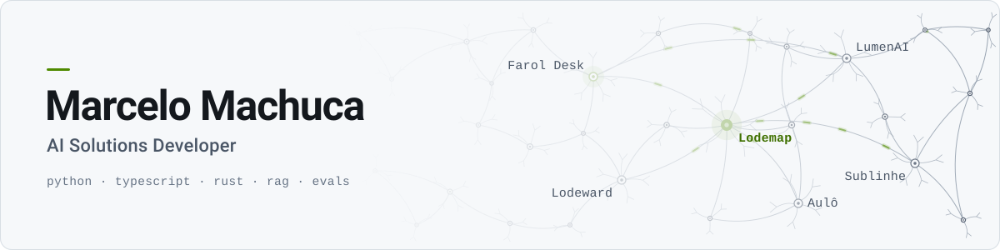

<p align="center">
  <picture>
    <source media="(prefers-color-scheme: dark)" srcset="./assets/banner-dark.svg" />
    
  </picture>
</p>

<p align="center">
  AI Solutions Developer working with Python, TypeScript, Rust, RAG, evals and observability.
  I came from medicine. I design AI systems and direct the coding agents that write them.
  My part is the architecture, the boundaries and the proof. <b>Open&nbsp;to&nbsp;roles.</b>
</p>

<p align="center">
  <a href="https://skarl007.github.io/"><b>Portfolio</b></a> &nbsp;·&nbsp;
  <a href="https://www.linkedin.com/in/marcelo-machuca-ia/"><b>LinkedIn</b></a> &nbsp;·&nbsp;
  <a href="https://skarl007.github.io/lodemap/#video">Lodemap film</a> &nbsp;·&nbsp;
  <a href="https://github.com/skarL007/lumen-ai-sdk">LumenAI SDK</a> &nbsp;·&nbsp;
  <a href="https://github.com/skarL007/nexo-assist">Farol Desk</a>
</p>

<br />

- **Hypothesis first.** I write it down before I measure, and I publish the result even when it is negative.
- **Every number has a source:** a test run, an eval file, a commit, a bill.
- **Agents write most of the code.** I own the design, the review and the gates that stop bad changes.

## Selected work

### Lodemap

A C4 architecture map that lives in the repository and fails the build when the code grows and the map does not.

- **Proof:** CI green on Linux, macOS and Windows. Released as [v0.1.0](https://github.com/skarL007/lodemap/releases/tag/v0.1.0).
- **A negative result, kept visible:** in a pre-registered experiment (96 runs) the map did **not** make a coding agent cheaper (median ratio 0.99). Answers were not worse. A study with people is pre-registered, not run yet.
- **See it:** [film](https://skarl007.github.io/lodemap/#video) · [live map of axios](https://skarl007.github.io/lodemap/demo/explorador/) · [repository](https://github.com/skarL007/lodemap)
- **Stack:** Python, Structurizr DSL, JS

### Also public

| Project | What it is | Proof | Stack |
|---|---|---|---|
| [Farol Desk](https://github.com/skarL007/nexo-assist) | IT service-desk agent that shows what it understood, asks before acting and hands off to a human. Formerly Nexo Assist. [Case study](https://skarl007.github.io/farol-desk/). | 573 unit and 48 E2E tests (11 Nov); evals 35/36 and red-team 21/21 (3 Nov); simulated-employee pass^3 0.50 → 0.80. CircleCI, Docker. | TypeScript, Next.js, Mastra |
| [LumenAI SDK](https://github.com/skarL007/lumen-ai-sdk) | Turns GenAI traces into per-tenant cost without exporting prompts. [Live demo](https://lumen-ai-sdk-demo.vercel.app). | On PyPI (0.1.6); cost checked against a real provider bill. | Python, OpenTelemetry |
| [VoiceLaunch TTS](https://github.com/skarL007/sound_voice) | Assistive TTS app: typing becomes a virtual microphone, with local fallback. | 165 tests, tagged releases. | Electron, React, Python |

## Private case studies

These are private for now. The write-ups are on the [portfolio](https://skarl007.github.io/), and I can walk through any of them in an interview.

| Project | What it does | Proof |
|---|---|---|
| **Sublinhe** | Closed-corpus RAG for health students: flashcards, questions and oral practice that always cite the page, and abstain when the source does not support an answer. BGE-M3 + FAISS + BM25, RRF fusion, reranker, LLM-judge evals. | 1,140 commits on main; MVP closed on 5 Oct 2026. |
| **Lodeward** | Governance for coding agents over MCP, in Rust: a pre-execution firewall that inspects every shell command an agent proposes, plus associative memory. Formerly SynapseEngine. | 988 commits on main. Failed test rounds are logged, not hidden. |
| **Aulô** <br /><sub>in progress</sub> | Voice study platform for exams and medical school: you upload your own material and a virtual teacher answers only from it, shows the page behind each sentence and says when the answer is not there. Three teaching styles, on a local-first RAG core with citations. | Frontend done; retrieval quality is still being measured against its own target. [Case study](https://skarl007.github.io/aulo/). |

## Stack

```txt
Languages    Python, TypeScript, JavaScript, Rust
Backend      FastAPI, Node.js, Next.js, workers, REST APIs, MCP
AI           RAG, evals (LLM judge, pass^k), OpenTelemetry for GenAI, voice AI, agent workflows
Data/Infra   PostgreSQL, Redis, SQLite, Docker, CircleCI, GitHub Actions
Frontend     React, Electron, three.js
Practice     pre-registered experiments, tests, release gates, observability
```

<p align="center">
  <a href="https://skarl007.github.io/"><b>Portfolio</b></a> &nbsp;·&nbsp;
  <a href="https://www.linkedin.com/in/marcelo-machuca-ia/"><b>LinkedIn</b></a>
</p>
